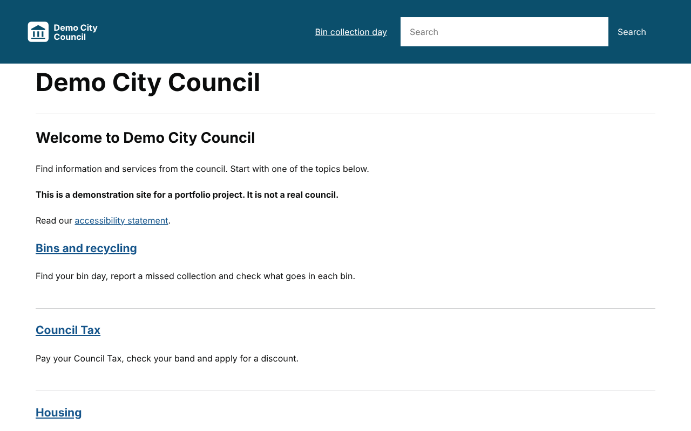
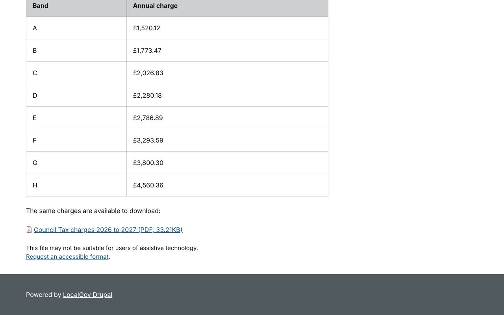
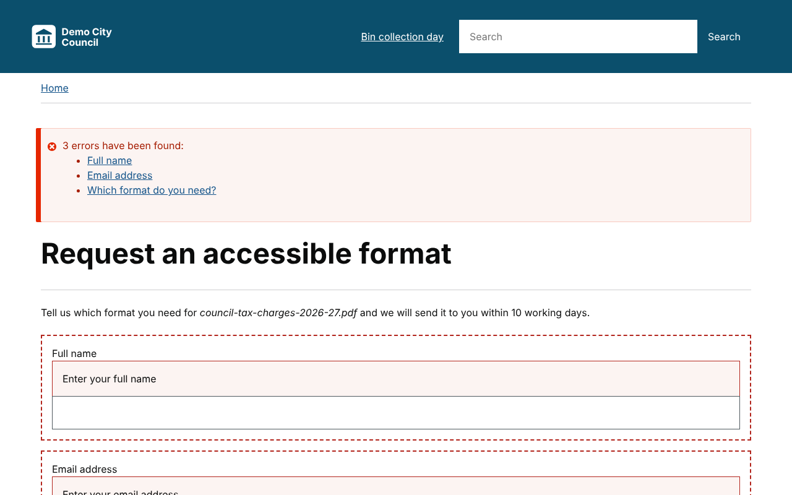
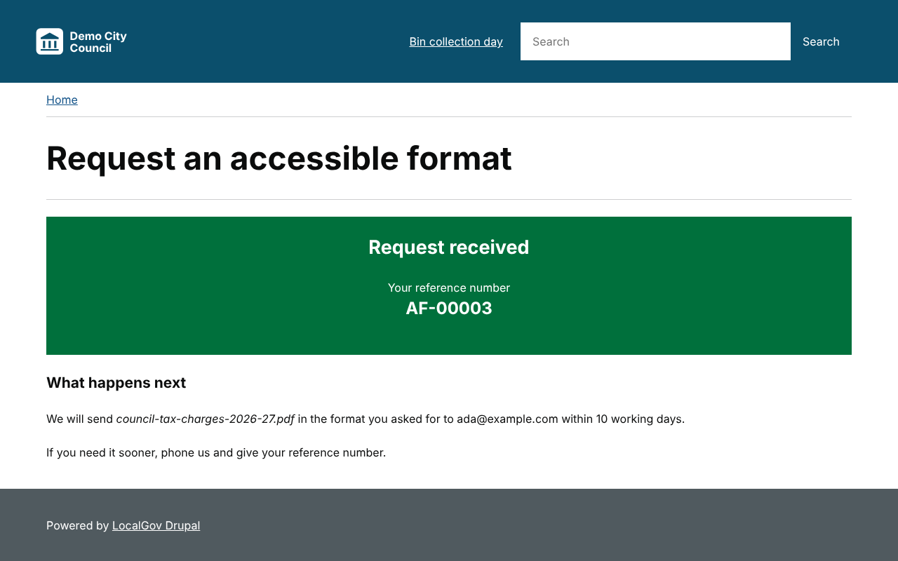
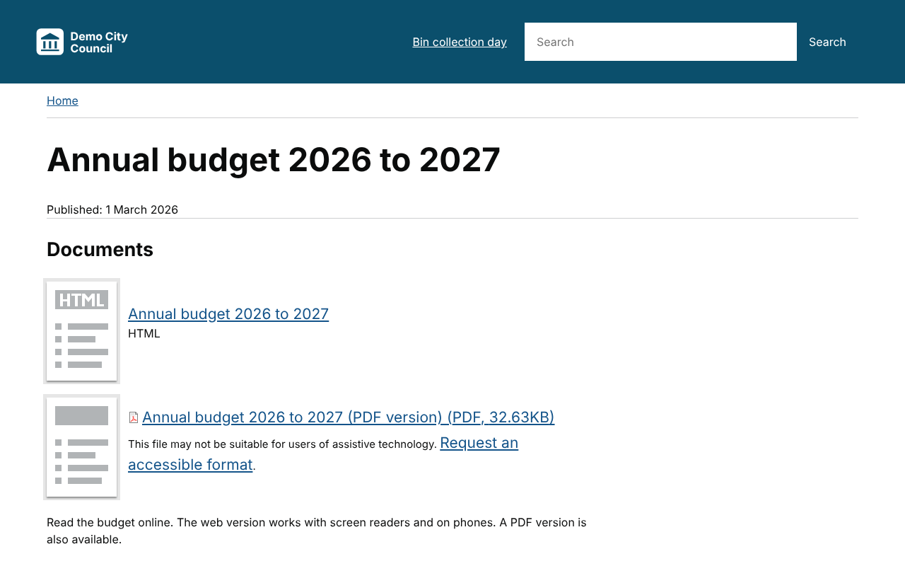
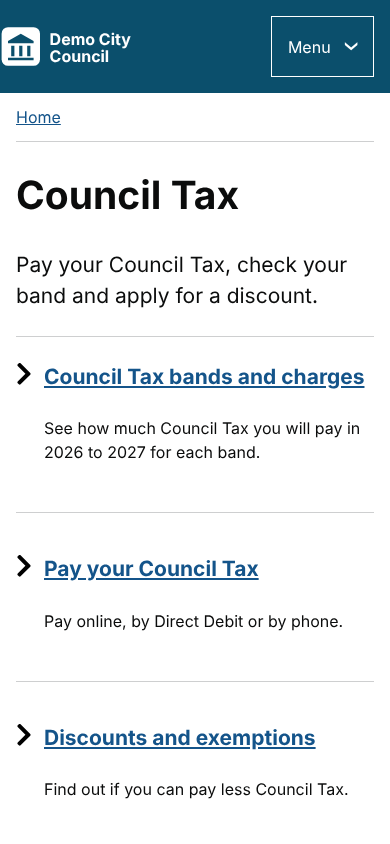

# Demo City Council on LocalGov Drupal

[](https://github.com/SamAde1203/localgov-council-microsite/actions/workflows/ci.yml)

A council website built on [LocalGov Drupal](https://localgovdrupal.org), the Drupal distribution that UK councils share. It runs LocalGov Drupal 4.0.5 on Drupal 11.4 and adds:

- **Accessible Formats**, a custom module. Every PDF or Word document gets a "Request an accessible format" link. Residents can ask for large print, Easy Read, audio or braille, and the content team manages requests in Drupal.
- **A WCAG 2.2 AA accessibility audit** with 10 findings, all fixed and written up in [docs/ACCESSIBILITY-AUDIT.md](docs/ACCESSIBILITY-AUDIT.md). Automated checks run on every push.
- **A Demo City Council theme**, a LocalGov Base sub-theme with a checked colour palette.
- **Realistic council content**: services for bins, Council Tax, housing and roads, a multi-page guide, an HTML-first budget publication and an accessibility statement.
- **Bin Day Finder**, the custom module from my [Council Services on Drupal 11](https://github.com/SamAde1203/council-services-drupal) project, running inside LocalGov.

> This is a portfolio project. "Demo City Council" is not a real organisation, and all content is fictional.

| Home page | Document with the request link | Request form errors |
|---|---|---|
|  |  |  |

| Request confirmation | HTML-first publication | Mobile |
|---|---|---|
|  |  |  |

## What it demonstrates

| Area | Where to look |
|---|---|
| Building on LocalGov Drupal | Services, guides and publications from the distribution; a sub-theme of LocalGov Base made with its own generator script |
| Custom module with a content entity | [`accessible_formats`](web/modules/custom/accessible_formats): an entity type declared with PHP attributes, a list builder, admin routes, permissions, a settings form with `#config_target` |
| Drupal 11 patterns | Hook classes with `#[Hook]`, services injected into hook classes and forms, a custom access check on a route |
| Accessibility | [Audit report](docs/ACCESSIBILITY-AUDIT.md), GOV.UK patterns for errors and confirmation, focus management, theme fixes for LocalGov Base |
| Content as code | [`DemoContent`](web/modules/custom/demo_city_content/src/DemoContent.php) builds every page with the Entity API, including paragraphs, media and a book-based publication |
| Testing | 42 PHPUnit tests (unit, kernel and functional) across the custom modules; axe-core and keyboard checks on 14 page states at two screen sizes |
| Code quality | Drupal and DrupalPractice coding standards (phpcs), enforced in CI |
| Security | Rate limiting with the flood service, requests only for real documents a visitor can download, restricted admin permission |

## The Accessible Formats module

UK councils publish a lot of PDFs, and many don't work with screen readers. GOV.UK's approach is to say so under the document and offer another format. The module does that automatically:

1. Under every PDF, Word, Excel or PowerPoint file it adds: *"This file may not be suitable for users of assistive technology. Request an accessible format."* The link includes the document's name for screen reader users.
2. The request form asks for a name, an email address and the format needed. Choosing "Another format" requires details.
3. The resident gets a reference number, such as AF-00012, and is told when to expect a reply. Focus moves to the confirmation so screen reader users hear it.
4. Staff see requests at **Content → Accessible format requests**, unanswered requests first, and tick them off when done. New requests can also be emailed to a team inbox.

Settings are at **Configuration → Web services → Accessible formats**: which file types show the notice, the response time, the notification email and a rate limit.

## Run it locally

You need [DDEV](https://ddev.readthedocs.io/en/stable/users/install/) and Docker.

```bash
git clone https://github.com/SamAde1203/localgov-council-microsite.git
cd localgov-council-microsite
ddev start
ddev composer install
ddev setup-site      # installs LocalGov Drupal, the custom modules, the theme and the content
ddev launch
```

`ddev setup-site` prints a one-time admin login link. You can also log in as `admin` with password `admin`.

## Run the checks

```bash
ddev exec vendor/bin/phpcs        # Drupal coding standards
ddev exec vendor/bin/phpunit      # unit, kernel and functional tests

npm install
npx playwright install chromium
BASE_URL=https://localgov-council.ddev.site npm run a11y   # accessibility checks
```

GitHub Actions runs all of this on every push. The accessibility job installs a fresh site, checks every page state and uploads screenshots.

## Limitations and next steps

- Manual testing with screen readers and real users is still to do (see the audit).
- Requests are stored and optionally emailed. A real council would connect them to its case management system.
- Possible additions: email confirmations to residents, request statistics for the content team, and an Easy Read guide template.

## Credits

Built on [LocalGov Drupal](https://localgovdrupal.org) (GPL-2.0-or-later). Postcode data in the bin day finder comes from [postcodes.io](https://postcodes.io), under the Open Government Licence.

Built by [Sam Adeyemi](https://samadeyemi.dev). Licensed under GPL-2.0-or-later, like Drupal.
